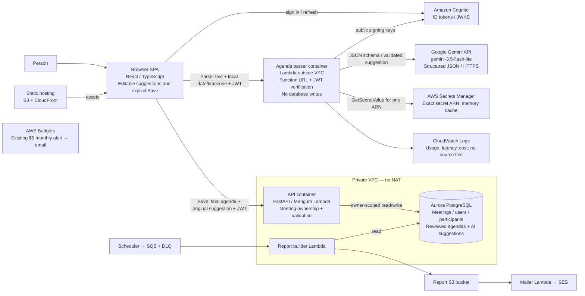

# Spry C4 level 2 — Lab 6

The API receives the pool's public JWKS at deployment because its VPC has no internet route.
The parser fetches JWKS outside the VPC. Refresh keys when Cognito rotates them; the pre-existing
API cache requires operational JWKS refresh/redeployment and is not a claim of permanent keys.
The diagram preserves Lab 5 report containers and adds the distinct parse/save paths for Lab 6.

**Current diagram is the Gemini 3.5 candidate: the user reports a validated real API probe; AWS parser deployment is pending.**
Original assignment: Claude Messages API. User-reported Opus 5.5/Haiku 5.5 AccessDenied led to
the deployed Nova fallback, which is blocked by zero applied account quotas. The user approved
Gemini as the next local candidate; instructor approval is still required. Contract and parse/save
arrows are unchanged. See `docs/lab6/gemini-replacement.md` (or `lab6/gemini-replacement.md` from docs).

Deployment now reuses the existing parser log group and `meetings-monthly-5usd` budget; neither
is recreated or deleted. Reserved concurrency is omitted for the current account by default.
A temporary private schema inspector may reuse the backend VPC/role/security group for fixed
read-only metadata SELECTs, but is not part of normal application traffic or permanent architecture.
See `lab6/database-inspection.md` for separately approved create/invoke/cleanup steps.

Deployment-readiness fixes: reserved concurrency is optional/off by default; existing parser logs
and the existing $5 budget are reused. The deployment helper verifies the friend account, pins and
checks image architecture, strips parser DB settings through its explicit environment allowlist,
and previews a change set by default. See [release runbook](docs/lab6/release-runbook.md) and
[private read-only inspection](docs/lab6/database-inspection.md). Neither a preview nor inspection
script has been executed; both can create cloud resources and require separate approval.
