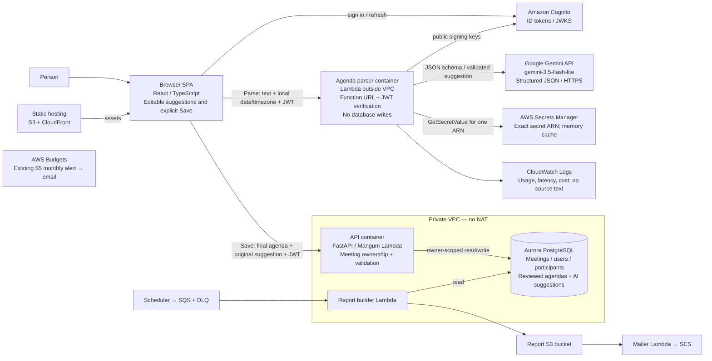

# Spry C4 level 2 — Lab 6

The API receives the pool's public JWKS at deployment because its VPC has no internet route.
The parser fetches JWKS outside the VPC. Refresh keys when Cognito rotates them; the pre-existing
API cache requires operational JWKS refresh/redeployment and is not a claim of permanent keys.
The diagram preserves Lab 5 report containers and adds the distinct parse/save paths for Lab 6.

**Current deployed architecture: Gemini 3.5 Flash-Lite; authenticated parsing verified.**
The original Claude requirement is unmet literally. User-reported Claude access denials led to Nova;
recorded zero applied Nova inference quotas blocked it. Gemini was approved by the project owner and
successfully tested, but requires instructor approval. See [final report](lab6/final-report.md).

Deployment now reuses the existing parser log group and `meetings-monthly-5usd` budget; neither
is recreated or deleted. Reserved concurrency is omitted for the current account by default.
A temporary private schema inspector may reuse the backend VPC/role/security group for fixed
read-only metadata SELECTs, but is not part of normal application traffic or permanent architecture.
See `lab6/database-inspection.md` for separately approved create/invoke/cleanup steps.
